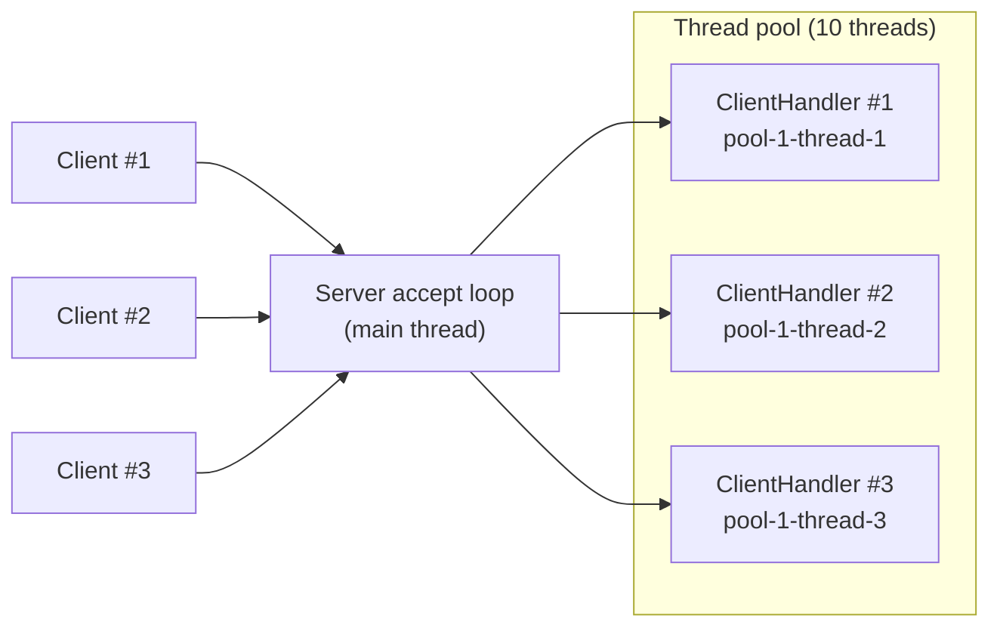

# Multithreaded Socket Server

A Java client-server application where one server handles several clients at the same time.
Each client first has to log in with a password. After that, the server sends back every message
it receives, either in uppercase or reversed, depending on the client's ID.

It started as a university lab exercise on sockets and multithreading, and I extended it into a
standalone project with a thread pool, a cleaner client and automated tests.

**Tech:** Java 17, TCP sockets, `ExecutorService` thread pool, JUnit 5, Maven

## Features

- Several clients are served at the same time, each one on its own thread from a thread pool
- Every client gets a sequential ID when it connects (#1, #2, #3, ...)
- Password login with 3 attempts. After the third wrong password the server closes the connection and the client program exits
- After login, the server answers every message:
  - **odd ID** → the message in UPPERCASE
  - **even ID** → the message reversed
- `quit` ends the session
- Server log with timestamps and thread names, so you can see which thread serves which client
- Clear messages for common mistakes (server not running, port already in use)

## How it works

The main thread only accepts connections. Every client is then served by its own thread from the pool until it disconnects.



| Class | What it does |
|---|---|
| `Server` | Listens on a port, gives every new connection the next ID (`AtomicInteger`) and hands it to a fixed thread pool (up to 10 clients at once) |
| `ClientHandler` | Runs on a pool thread: login with 3 attempts, then the message loop until `quit` |
| `ResponseMode` | Enum that decides what the reply looks like: `UPPERCASE` for odd IDs, `REVERSED` for even IDs |
| `Client` | Console client. A listener thread prints everything the server sends while the main thread reads the keyboard. When the server closes the connection, the client exits |

Messages are plain text over TCP, one message per line (UTF-8).

## Example

Server log, where you can see each client being handled by a different pool thread:

```
[22:00:57] [main] Server started on port 2026
[22:00:59] [main] Client #1 connected (127.0.0.1)
[22:01:00] [main] Client #2 connected (127.0.0.1)
[22:01:02] [pool-1-thread-1] Client #1 logged in (UPPERCASE)
[22:01:02] [pool-1-thread-2] Client #2 logged in (REVERSED)
[22:01:03] [pool-1-thread-1] Client #1: hello there
[22:01:03] [pool-1-thread-2] Client #2: hello there
[22:01:05] [main] Client #3 connected (127.0.0.1)
[22:01:08] [pool-1-thread-3] Client #3 failed to log in
[22:01:08] [pool-1-thread-3] Client #3 disconnected
[22:01:09] [pool-1-thread-1] Client #1 disconnected
[22:01:09] [pool-1-thread-2] Client #2 disconnected
```

Client #1 (odd ID, gets uppercase):

```
Connected to localhost:2026
Server: Welcome! You are client #1.
Server: Enter password:
Raf123
Server: Login successful. Your messages will be returned in UPPERCASE. Type 'quit' to exit.
hello there
Server: HELLO THERE
quit
Server: Goodbye!
Disconnected from server.
```

Client #2 (even ID, gets the message reversed):

```
Connected to localhost:2026
Server: Welcome! You are client #2.
Server: Enter password:
Raf123
Server: Login successful. Your messages will be returned reversed. Type 'quit' to exit.
hello there
Server: ereht olleh
quit
Server: Goodbye!
Disconnected from server.
```

Client #3 (wrong password three times, so the client program shuts down):

```
Connected to localhost:2026
Server: Welcome! You are client #3.
Server: Enter password:
raf123
Server: Wrong password (attempts left: 2). Try again:
Raf 123
Server: Wrong password (attempts left: 1). Try again:
password
Server: Wrong password. No attempts left, closing connection.
Disconnected from server.
```

## Getting started

**Requirements:** Java 17 or newer and Maven (IntelliJ IDEA already comes with Maven).

### IntelliJ IDEA

1. **File → Open** and choose the project folder (the one with `pom.xml`)
2. Run `server.Server`
3. Run `client.Client`. To start more than one client, go to **Run → Edit Configurations → Client → Modify options** and turn on **Allow multiple instances**

The password is `Raf123` (the `PASSWORD` constant in `ClientHandler`).

### Command line

```bash
mvn package
java -cp target/multithreaded-socket-server-1.0.jar server.Server
```

Then, in one or more new terminals:

```bash
java -cp target/multithreaded-socket-server-1.0.jar client.Client
```

Both programs accept optional arguments: `server.Server [port]` and `client.Client [host] [port]` (defaults are `localhost` and `2026`).

## Tests

```bash
mvn test
```

- `ResponseModeTest`: unit tests for choosing and applying the response mode
- `ServerTest`: integration tests that start the server on a free port and connect real clients over sockets. They check sequential IDs, uppercase/reversed replies, closing the connection after 3 wrong passwords, and `quit`

## Project structure

```
src
├── main/java
│   ├── client
│   │   └── Client.java
│   └── server
│       ├── ClientHandler.java
│       ├── ResponseMode.java
│       └── Server.java
└── test/java
    └── server
        ├── ResponseModeTest.java
        └── ServerTest.java
```

## Possible improvements

- Encrypt the connection with TLS, since the password is currently sent as plain text
- Tell a client when the server is full, instead of letting it wait for a free thread
- Read the port and password from a config file instead of constants
- Turn it into a group chat by broadcasting messages to all connected clients

## License

MIT, see [LICENSE](LICENSE).
